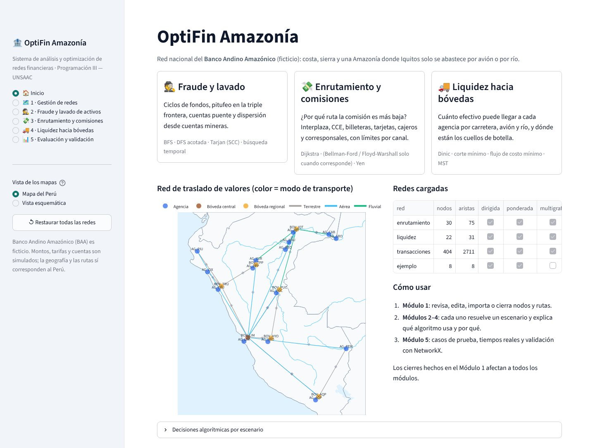
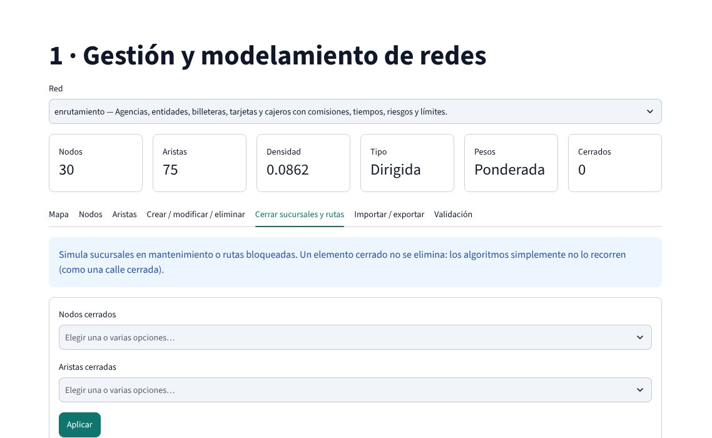
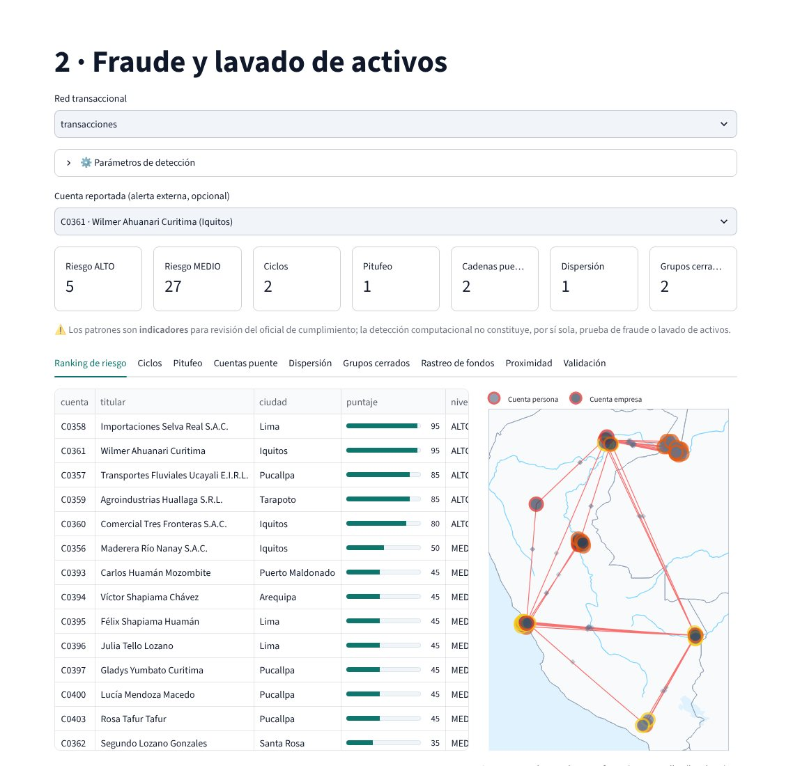
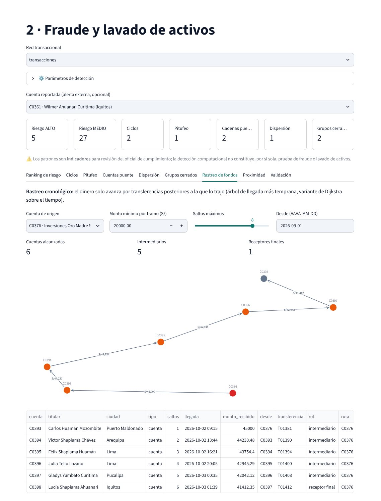
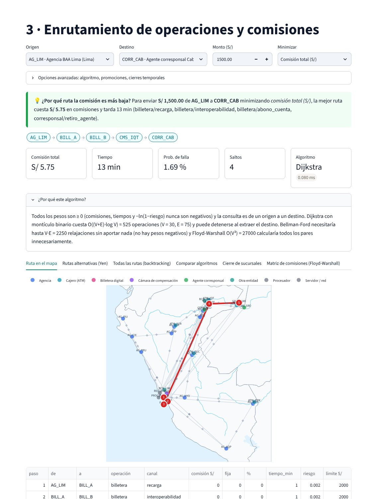
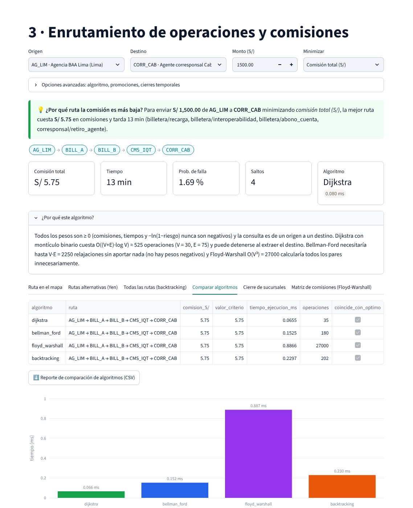
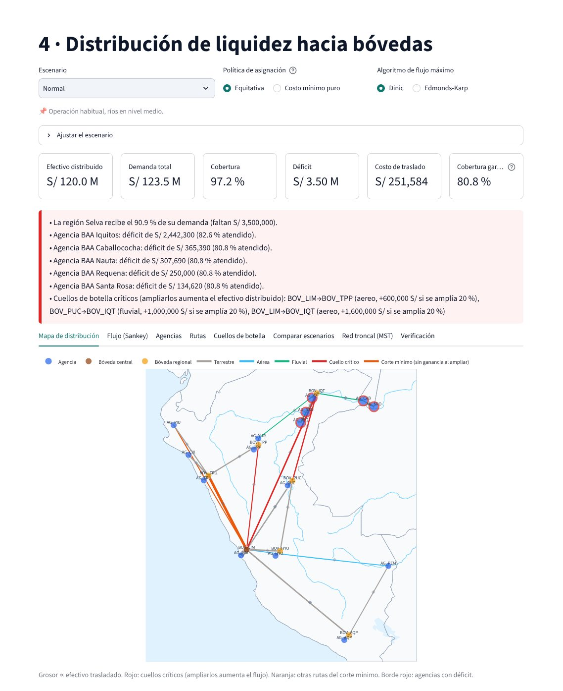
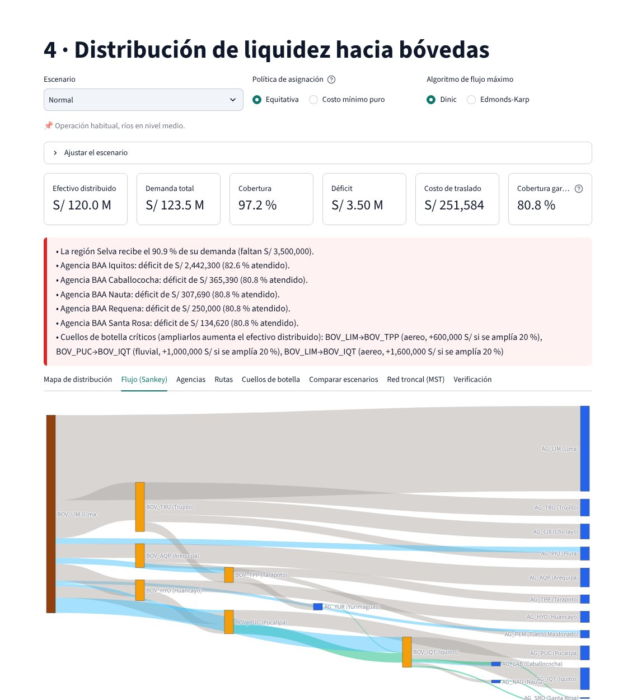
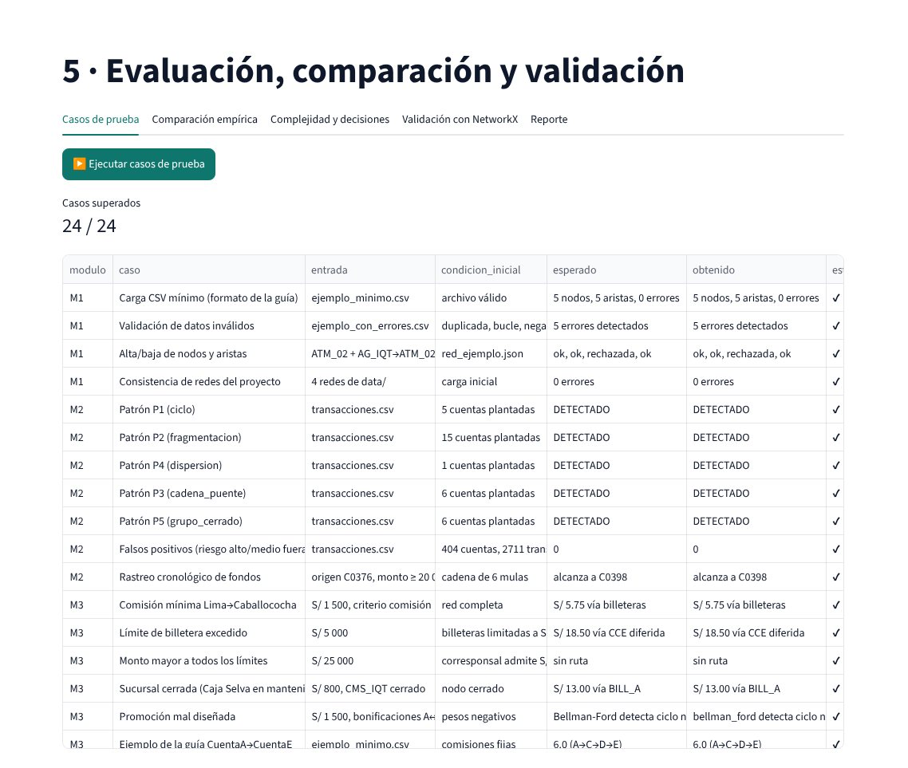

# Guía de uso del programa

**OptiFin Amazonía** — Sistema de Análisis y Optimización de Redes Financieras
Proyecto II · Programación III · UNSAAC · Versión 1.0.0

---

## 1. ¿Qué hace el programa?

Modela como un **grafo** la red de un banco **ficticio**, el *Banco Andino Amazónico*, con agencias en costa, sierra
y selva. Los **nodos** son agencias, bóvedas, cuentas, cajeros o billeteras digitales, y las **aristas** son
transferencias, canales de pago o rutas de transporte de efectivo. Sobre esa red resuelve tres problemas:

| Escenario | Pregunta | Algoritmo |
|---|---|---|
| Fraude y lavado de activos | ¿Qué cuentas tienen patrones sospechosos? | BFS, DFS, Tarjan |
| Enrutamiento y comisiones | ¿Por qué ruta la comisión es más baja? | Dijkstra |
| Liquidez hacia bóvedas | ¿Cuánto efectivo llega a cada agencia y dónde está el cuello de botella? | Dinic (flujo máximo) |

Los montos y entidades son simulados; las ciudades y rutas corresponden al Perú.

---

## 2. Requisitos del equipo

| Componente | Mínimo | Recomendado |
|---|---|---|
| Sistema operativo | Windows 10 (64 bits), Ubuntu 22.04 o macOS 12 | Windows 11 |
| Procesador | 2 núcleos, 64 bits | 4 núcleos o más |
| Memoria RAM | 4 GB | 8 GB |
| Disco libre | 500 MB | 1 GB |
| Pantalla | 1366 × 768 | 1920 × 1080 |
| Python | 3.11 (si no está instalado, `INICIAR.bat` lo instala) | 3.12 o 3.13 |
| Navegador | Chrome, Edge o Firefox actualizados | Chrome |
| Internet | Solo la primera vez (descarga de bibliotecas) | — |

Bibliotecas, con versión fija en `requirements.txt`: `streamlit 1.67.0`, `plotly 7.2.0`, `pandas 3.0.5`,
`networkx 3.7` (solo para validar resultados) y `pytest 9.1.1`. Todos los algoritmos están programados desde cero.

---

## 3. Instalación y ejecución paso a paso

### Opción A · Un clic (Windows)

1. En GitHub pulse **Code → Download ZIP** y luego **extraiga** el ZIP (clic derecho → *Extraer todo*).
2. En la carpeta `proyecto_optifin`, haga **doble clic en `INICIAR.bat`**.
   * **Primera vez:** instala todo automáticamente (1–3 min, requiere internet; si falta Python también lo instala).
   * **Siguientes veces:** abre en segundos.
3. El navegador se abre solo en `http://localhost:8501`.

| Aviso | Qué hacer |
|---|---|
| "Windows protegió su PC" | **Más información → Ejecutar de todas formas** |
| "No se encontró Python" | Espere a que se instale, cierre la ventana y vuelva a hacer doble clic en `INICIAR.bat` |

> Mientras use el programa **no cierre la ventana negra**. Para salir, cierre el navegador y esa ventana.

### Opción B · Manual (Windows, Linux o macOS)

```
git clone <url-del-repositorio>          # o descargar el ZIP y extraerlo
cd proyecto_optifin
python -m venv .venv                     # crear el entorno virtual
.venv\Scripts\activate                   # Windows   (Linux/macOS: source .venv/bin/activate)
pip install -r requirements.txt          # instalar bibliotecas
python main.py                           # abrir la interfaz web
```

| Comando | Uso |
|---|---|
| `python main.py` | Interfaz web (se abre el navegador) |
| `python main.py --cli` | Menú en la terminal, sin navegador |
| `python main.py --demo` | Ejecuta los 5 módulos y guarda reportes CSV/JSON en `reports/` |
| `bash iniciar.sh` | Un clic en Linux/macOS (instala la primera vez) |

### Verificar la instalación y reproducir los resultados

| Comando | Resultado esperado |
|---|---|
| `python -m pytest -q` | `38 passed` (pruebas automáticas de los 5 módulos) |
| `python main.py --demo` | `Casos superados: 24 / 24` y reportes en `reports/` |
| `python scripts/generar_datos.py` | Regenera exactamente los mismos datos (semilla fija 2026) |

---

## 4. Datos de prueba (carpeta `data/`)

| Archivo | Módulo | Contenido |
|---|---|---|
| `red_enrutamiento.csv` + `nodos_enrutamiento.csv` | 3 | 30 puntos y 75 canales: interplaza, interbancaria (CCE), billeteras, tarjetas de débito y crédito, cajeros y corresponsales, con comisión fija y %, tiempo, riesgo y límite |
| `distribucion_liquidez.csv` + `nodos_liquidez.csv` | 4 | 7 bóvedas y 15 agencias con oferta/demanda; 31 rutas terrestres, aéreas y fluviales con capacidad y costo |
| `escenarios_liquidez.json` | 4 | Parámetros de los 6 escenarios |
| `transacciones.csv` + `cuentas.csv` | 2 | 2 711 transferencias entre 404 cuentas (monto, fecha, canal, concepto) |
| `patrones_plantados.json` | 2 | Los 5 patrones sospechosos insertados (verdad de referencia) |
| `red_ejemplo.json`, `ejemplo_minimo.csv`, `ejemplo_con_errores.csv` | 1 | Red de ejemplo, formato mínimo de la guía y datos inválidos para probar la validación |

Formato CSV: columnas `origen,destino` y luego los atributos de la conexión. Los datos son adecuados porque cada
canal tiene ventajas y límites distintos (la ruta óptima cambia con el monto), Iquitos solo se abastece por avión o
río (cuellos de botella reales) y las transacciones mezclan movimientos normales con patrones de ubicación conocida.

---

## 5. La pantalla



* **Menú izquierdo:** Inicio y Módulos 1 a 5; *Vista de los mapas* (mapa del Perú o vista esquemática);
  **↺ Restaurar todas las redes** deshace todos los cambios.
* **Pestañas** bajo el título de cada módulo: cada una es un análisis distinto.
* **Mapas:** pase el cursor sobre puntos y rombos para ver datos; rueda del ratón para acercar.
* **Tablas y gráficos:** botones para descargar en CSV o PNG al pasar el cursor.

---

## 6. Módulo 1 · Gestión de redes

Elija la red (`enrutamiento`, `liquidez`, `transacciones` o `ejemplo`) y use las pestañas:

| Pestaña | Uso |
|---|---|
| Mapa / Nodos / Aristas | Ver la red y sus datos |
| Crear / modificar / eliminar | Agregar o editar nodos y aristas. Atributos con formato `clave=valor; clave=valor`, por ejemplo `comision_fija=2.5; tiempo_min=10` |
| Cerrar sucursales y rutas | Simula sucursales en mantenimiento o rutas bloqueadas (afecta a todos los módulos). Elegir y pulsar **Aplicar** |
| Importar / exportar | Cargar CSV (`origen,destino,…`), JSON o TXT (`origen destino peso`); descargar la red |
| Validación | Detecta nodos inexistentes, valores inválidos y duplicados; muestra la lista de adyacencia |

**Cerrar una sucursal (calle cerrada):** en *Cerrar sucursales y rutas* elija, por ejemplo, `AG_IQT` y pulse **Aplicar**.
El punto aparece en rojo en el mapa y ningún módulo lo usa hasta que se quite o se pulse **↺ Restaurar todas las redes**.



---

## 7. Módulo 2 · Fraude y lavado de activos



Analiza 2 711 transferencias. Las tarjetas superiores muestran cuántas cuentas tienen riesgo ALTO y MEDIO.

| Pestaña | Qué detecta |
|---|---|
| Ranking de riesgo | Puntaje 0–100 por cuenta (ALTO ≥ 60, MEDIO ≥ 30) con sus motivos |
| Ciclos | Dinero que sale y vuelve al origen entre empresas fachada |
| Pitufeo | Muchos depósitos justo bajo el umbral (S/ 10 000) hacia una misma cuenta |
| Cuentas puente | Cuentas que reenvían casi todo lo recibido en pocas horas |
| Dispersión | Una cuenta que reparte dinero a muchas (sin contar planillas) |
| Grupos cerrados | Cuentas donde el dinero circula entre todas |
| Rastreo de fondos | Camino del dinero en orden cronológico desde una cuenta |
| Proximidad | A cuántos saltos están dos cuentas |
| Validación | Compara con los 5 patrones plantados: deben salir **5 DETECTADOS, 0 falsos positivos** |

Cada pestaña tiene su reporte descargable (botón **⬇️ Reporte completo (JSON)** y descarga CSV de cada tabla).

En **⚙️ Parámetros de detección** se ajusta la sensibilidad (umbral, ventanas de tiempo, etc.).
Los resultados son indicadores para revisión, no prueba de delito.

**Rastreo de fondos:** elija la cuenta de origen, el monto mínimo por tramo y los saltos máximos. El diagrama muestra
el recorrido del dinero (rojo = origen, naranja = intermediarias) y la tabla indica fecha, monto y rol de cada cuenta.
Ejemplo: desde `C0376` el dinero pasa por 5 cuentas puente en menos de un día.



---

## 8. Módulo 3 · Enrutamiento y comisiones



1. Elija **Origen**, **Destino**, **Monto** y qué **Minimizar** (comisión, tiempo, riesgo o combinado).
2. El recuadro verde responde *¿por qué ruta la comisión es más baja?* y **¿Por qué este algoritmo?** justifica el uso de Dijkstra.
3. En **Opciones avanzadas** puede forzar otro algoritmo, activar promociones (pesos negativos) o cerrar puntos.

Pestañas: **Ruta en el mapa**, **Rutas alternativas (Yen)**, **Todas las rutas (backtracking)**,
**Comparar algoritmos**, **Cierre de sucursales** y **Matriz de comisiones (Floyd-Warshall)**.
Los botones **⬇️ Reporte comparativo** descargan rutas, costos y comisiones en CSV.

| Prueba | Resultado esperado |
|---|---|
| `AG_LIM` → `CORR_CAB`, S/ 1 500 | S/ 5.75 por billeteras digitales |
| Mismo envío, S/ 5 000 | S/ 18.50 por la CCE (la billetera admite hasta S/ 2 000) |
| Mismo envío, S/ 25 000 | Sin ruta: supera los límites de los canales |
| Promoción `promo_interoperabilidad` | Cambia a Bellman-Ford y detecta un ciclo negativo |

**Comparar algoritmos:** ejecuta Dijkstra, Bellman-Ford, Floyd-Warshall y backtracking sobre la misma consulta.
Todos llegan a la misma ruta, pero Dijkstra lo hace con menos operaciones y en menos tiempo: por eso es el elegido.



---

## 9. Módulo 4 · Liquidez hacia bóvedas



1. Elija el **Escenario**: Normal, Vaciante, Diciembre, Vuelo cancelado, Bloqueo carretera central o Crisis amazónica.
2. Elija la **Política**: *Equitativa* (garantiza un mínimo a toda agencia) o *Costo mínimo puro*.
3. Lea las tarjetas (efectivo distribuido, cobertura, déficit, costo) y las alertas en rojo.

Pestañas: **Mapa de distribución** (grosor = efectivo; rojo = cuello de botella), **Flujo (Sankey)**, **Agencias**,
**Rutas**, **Cuellos de botella** (simula ampliar una ruta), **Comparar escenarios**, **Red troncal (MST)** y
**Verificación**. Montos en miles de soles por semana. En *Agencias* y *Rutas* se descargan los reportes de
cantidades distribuidas, capacidades utilizadas y necesidades pendientes.

| Escenario | Resultado esperado |
|---|---|
| Normal | S/ 120.0 M de S/ 123.5 M (97.2 %); toda agencia recibe al menos 80.8 % |
| Vuelo cancelado | Baja a S/ 112.0 M (90.7 %) |

**Flujo (Sankey):** el ancho de cada banda es el efectivo que pasa de una bóveda a otra o a una agencia
(gris = carretera, celeste = avión, verde = río).



---

## 10. Módulo 5 · Evaluación y validación

| Pestaña | Uso |
|---|---|
| Casos de prueba | Esperado vs. obtenido de cada módulo: deben salir **24 / 24 ✔** |
| Comparación empírica | Elegir familia de algoritmos y tamaños, pulsar **▶️ Ejecutar comparación**: gráfico de tiempos y exponente empírico |
| Complejidad y decisiones | Algoritmo elegido o descartado en cada escenario y por qué |
| Validación con NetworkX | Compara resultados con una biblioteca de referencia |
| Reporte | Descarga un resumen en Markdown |



---

## 11. Recorrido guiado de 10 minutos

1. **Inicio:** los tres escenarios y el mapa con carretera, avión y río.
2. **Módulo 1:** *Validación* → "Red consistente"; cerrar `AG_IQT` y ver el cambio en el mapa; restaurar.
3. **Módulo 3:** `AG_LIM` → `CORR_CAB` con S/ 1 500 (S/ 5.75), luego S/ 5 000 (cambia la ruta por el límite);
   *Comparar algoritmos*; activar `promo_interoperabilidad` (ciclo negativo).
4. **Módulo 4:** escenario *Normal* y luego *Vuelo cancelado*; en *Cuellos de botella*, simular ampliar `L024`.
5. **Módulo 2:** *Ranking de riesgo*, *Pitufeo* (triple frontera → Iquitos → Lima) y *Rastreo de fondos*.
6. **Módulo 5:** casos de prueba **24 / 24** y gráfico de *Comparación empírica*.

---

## 12. Problemas frecuentes

| Problema | Solución |
|---|---|
| `INICIAR.bat` se cierra enseguida | Verifique que extrajo el ZIP antes de abrirlo |
| El navegador no se abrió | Entre a `http://localhost:8501` (o la dirección que muestre la ventana negra) |
| La página dice "Connection error" | Se cerró la ventana negra: vuelva a hacer doble clic en `INICIAR.bat` |
| El mapa se ve en blanco | Menú izquierdo → **Vista esquemática** |
| Quiero deshacer mis cambios | **↺ Restaurar todas las redes** |
| Reinstalar desde cero | Borrar la carpeta `.venv` del proyecto y volver a ejecutar `INICIAR.bat` |
